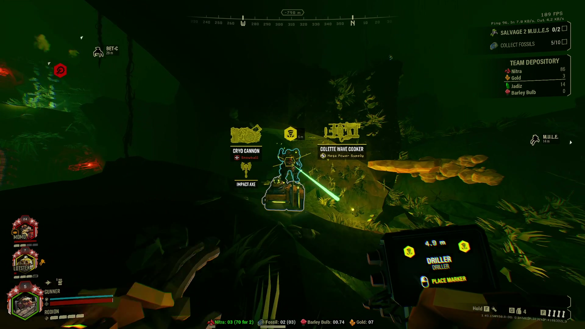

# Dwarf Builds

[](https://github.com/byrodi/dwarf-builds-drg/releases/latest)
[](LICENSE)
[](https://mod.io/g/drg/m/dwarf-builds)

Deep Rock Galactic mod: see your whole team's builds in game and share them as build codes.

Builds are shared on the Dwarf Builds website, [byrodi/dwarf-builds-web](https://github.com/byrodi/dwarf-builds-web),
included here as the `Web` submodule.


## Features

- Press B to see every player's weapons, upgrades, overclocks, equipment and perks. With
  [Mod Hub](https://mod.io/g/drg/m/mod-hub) the key can be changed on the mod's page there.
- The class selection screen shows your team's builds next to yours.
- Hold the laser pointer on a teammate: their weapons, overclocks, grenade and perks float around them.
- Copy any build as a short code, or paste one to preview it.
- TAKE BUILD saves a code into one of your loadouts, using only what you own.
- BROWSE opens the build website in the Steam overlay.
- Client-side: other players do not need the mod.

The game does not send a client other players' perks, and only part of their upgrades. When the host runs the mod
too, every player who has it shares their full build and perks with everyone; players without it show what the
game sends. Lobbies can mix this version, 0.1.0 and players without the mod.

## Screenshots

**Loadout scan (laser pointer).** Hold the pointer on a teammate: their weapons with overclocks, grenade and perks
float around them in their class colour.



**The window (B).** One column per player: weapons with every upgrade tier, overclocks, equipment and perks,
with tooltips in the game's style.


**TAKE BUILD.** Save a teammate's build into one of your loadout slots; only what you own is applied.


**Build codes.** Paste a code on the BUILD CODE tab, check the preview, then take it.


**The website.** Find and share builds on the Dwarf Builds website ([source](https://github.com/byrodi/dwarf-builds-web)); BROWSE opens it
in the Steam overlay.


## Installation

Subscribe on [mod.io](https://mod.io/g/drg/m/dwarf-builds), or download `dwarf-builds-0.4.0.zip` from the
[latest release](https://github.com/byrodi/dwarf-builds-drg/releases/latest) and add it to
[mint](https://github.com/trumank/mint) as a local mod, then install the profile. Or build it from source (below).

## Usage

| Key or button | What it does |
| --- | --- |
| Laser pointer held on a teammate | Their weapons, overclocks, grenade and perks float around them. |
| B (or your key from Mod Hub) | Opens the window (when no other game window is open). The same key or Escape closes it. |
| TEAM | Everyone in the lobby, one column per player. |
| BUILD CODE | Paste a code, preview it, take it into a loadout, copy or publish your own. |
| BROWSE | The website in the Steam overlay. |

Copy a code on the website, then press PASTE FROM CLIPBOARD on the BUILD CODE tab.

## Building from source

You need Unreal Engine 4.27, Python 3.11 or newer, Deep Rock Galactic installed and a project made from
[FSD-Template](https://github.com/DRG-Modding/FSD-Template).

1. Clone with the website: `git clone --recurse-submodules https://github.com/byrodi/dwarf-builds-drg.git`.
   Copy `Tools`, `Plugins/BPForge` and `Web` into the template project.
2. Build the BPForge editor plugin (it writes Blueprints from a spec):
   ```
   <UE_4.27>\Engine\Build\BatchFiles\Build.bat FSDEditor Win64 Development -Project=<project>\FSD.uproject -Module=BPForge
   ```
   A module-only build writes no `UE4Editor.modules` file. If the editor does not load the plugin, copy that file
   from another plugin's `Binaries/Win64` and change the module name to BPForge.
3. In the template, run `DRGModdingAutomationScripts\UtilityBats\MakeDefaultConfigFiles.bat` and set the engine
   and game paths in `Configs\LocalConfig.ini`.
4. Generate the assets into `Content/_DwarfBuilds` (without `--save` it only compiles them as a check):
   ```
   python Tools/dwarfbuilds_build.py --save
   ```
   `--dev` makes a test build: the laser pointer scan also works on bots (for example
   [Beard Bots](https://mod.io/g/drg/m/beard-bots)) and enemies, with sample builds. Never release a dev build.
5. Cook and pack. The pak lands in `DRGModdingAutomationScripts/Temp/dwarfbuilds.pak`:
   ```
   python Tools/pack_mod.py _DwarfBuilds dwarfbuilds
   ```
6. Optional, with mint and the game closed: `python Tools/install_mint.py <mint exe> --pak dwarfbuilds`.

The Blueprints live as code in `Tools/dwarfbuilds`; edit them there, not in the editor. Generated assets are not
in git.

The website's game data comes from the installed game: `python Tools/dwarfbuilds_export.py --game <DRG folder>`
reads the game's pak and writes `Web/public/data` and `Web/public/img`.

## Credits

The idea and the window layout come from [Build Inspector](https://mod.io/g/drg/m/build-inspector) by
AssemblyStorm. Dwarf Builds is a remake with its own assets and code.

## License

[MIT](LICENSE)
